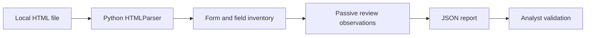

# 🕵️ Form Slayer 9000 — Passive HTML Form Audit

A **working Python standard-library CLI** for reviewing HTML forms in **local files**. It inventories methods, actions, and fields and produces explainable review observations. **This is not an XSS or SQL-injection scanner**, does not send requests, and does not confirm vulnerabilities.

## 🧭 How it works



## ▶️ Run it on Windows

From the repository root, with Python 3.9+:

```powershell
py -3 form_slayer.py examples\fictional_form.html --output report.json
Get-Content report.json
py -3 -m unittest discover -s tests -v
```

On Linux/macOS, replace `py -3` with `python3` and use `examples/fictional_form.html`.

The example fixture is **fictional**, not a real website. The script reads local files only, uses no network, and requires no third-party packages.

## 🔍 Current checks

- Form method and action inventory.
- Input, select, and textarea field names/types.
- Review cue for a password field in a GET form.
- Review cue for missing explicit form action.
- Review cue for forms with no named fields.

These are **review prompts**, not confirmed vulnerabilities. The parser does not execute JavaScript, interpret browser DOM changes, validate server-side controls, or establish XSS/SQLi exploitability.

## 🧪 Verification

Run the included unit tests and review the JSON generated from the fixture. A test suite passing demonstrates only the behavior covered by those tests; it is not a penetration test or a security guarantee.

## 🔐 Scope and responsible use

Inspect only files you own or are authorized to review. No active scanning, payload injection, external network connections, or collection of user credentials occurs.

## 📌 Status

**Implemented:** passive local HTML form inventory, JSON reporting, fictional fixture, unit tests. **Not implemented:** live website crawling, XSS/SQLi exploitation or verification, authentication analysis, or production-grade security scanning. Older README claims about those features were aspirational and have been corrected.
